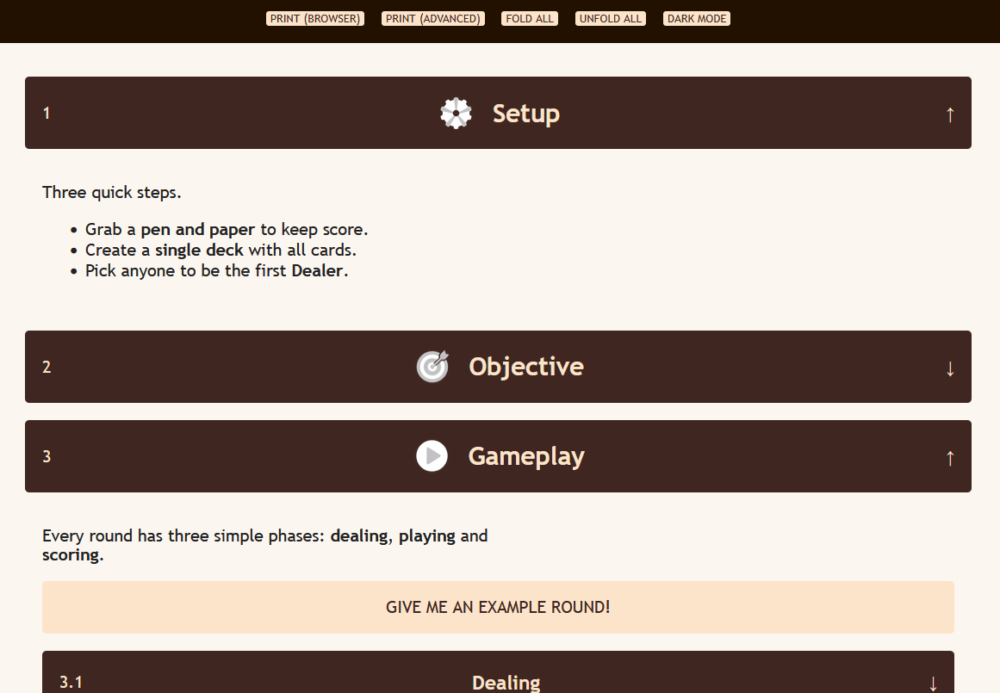

# PQ Rulebook

A TypeScript library for turning **HTML pages** into **interactive rulebooks (for board games)**.

I use it for my "playful rules" at [Pandaqi](https://pandaqi.com). It is finished and usable generically, but its functionality is tailored to what my game studio website needs.

## How To Use?

Three steps.

* Add the library to your project (everything in `src` folder). 
* Write your rulebook (in Markdown, or just plain HTML) and put it inside an element with id `rulebook-content`
* On the page containing your rulebook, include a script that calls `loadRulebook(config)` at some point.

See the docs for everything `config` can do. You likely don't need any of it and can just ignore it!

@TODO: I'm looking into providing a compiled `.js` file and hosting this as a Node package.

## Why To Use?

It turns a web page into an _interactive rulebook_. Because that's by far the best and most fun way to learn a new game!

* **Support "interactive examples"**: you click a button and it generates a random turn/round of the board game for you, including explanations for why things happened this way. (You must write the logic for this yourself as it highly depends on the game, of course.)
* Chop a rulebook into sections that can **fold/unfold**.
* It automatically numbers these sections, unfolds + jumps to one if you click a reference to another section, allows adding an icon/graphic to them, and more.
* **Create "rules tables"**: a table/grid with images of elements in the game (e.g. powerups or tiles). When clicked it gives you the explanation for it.
* **Support "remarks"**: things you want in the side margin or that are clearly less important than the main body of rules
* Many different ways to add images: regular, next to text, as a carousel of multiple images. All images can be clicked to view in fullscreen.
* A toggle that switches to "PDF" mode: now you can visit the rules in a (modern) browser, press CTRL+P, and get a **printable version** of the rulebook. 

It is somewhat opinionated. For example, it only supports sections and subsections, no further hierarchy. Why? Because you might think you need it, but you don't ;) Nesting deeper than that makes _anything_ way too complicated and unstructured, especially rulebooks.

Using PDFs for (board game) rulebooks is absolutely the right choice in many situations. You have way more control over layout and can make it look much prettier. In fact, all the board games I sell for money (at my online store) have PDF rulebooks. 

I made this framework purely because I wanted my rulebooks to be _interactive_, _open source_, _free to access_, and _easy to edit_. An experiment, an innovation, a different way to do it.

## HUGO Integration

I originally created this library for my Pandaqi website, which uses the HUGO static website generator.

You can find the partial and shortcodes in the `hugo` folder that I use to create my rulebooks even more quickly. 

You _don't need them_, though! A simple Markdown > HTML page will do fine. Those shortcodes are just wrappers for creating HTML elements with a specific class name.